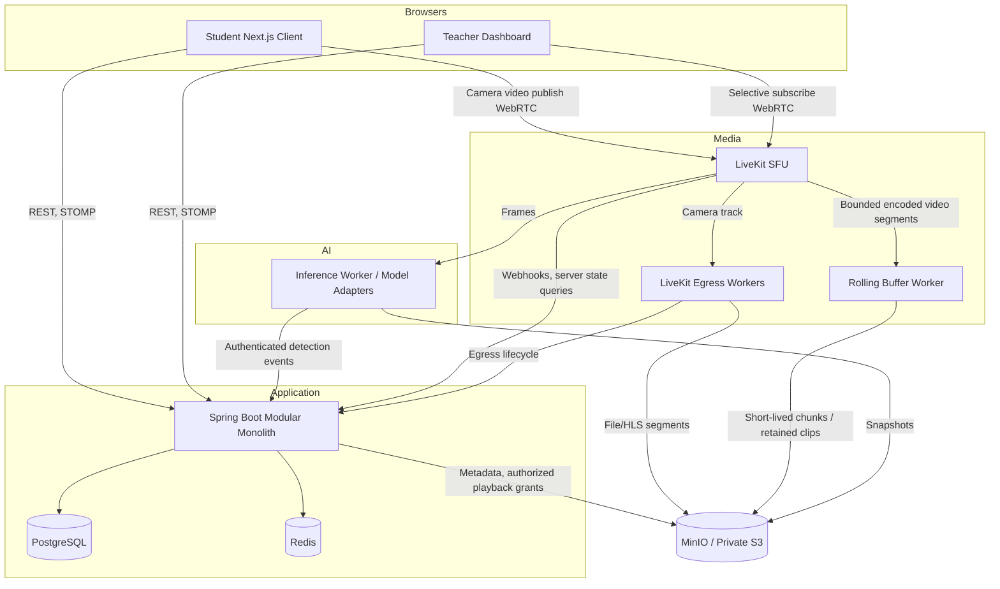
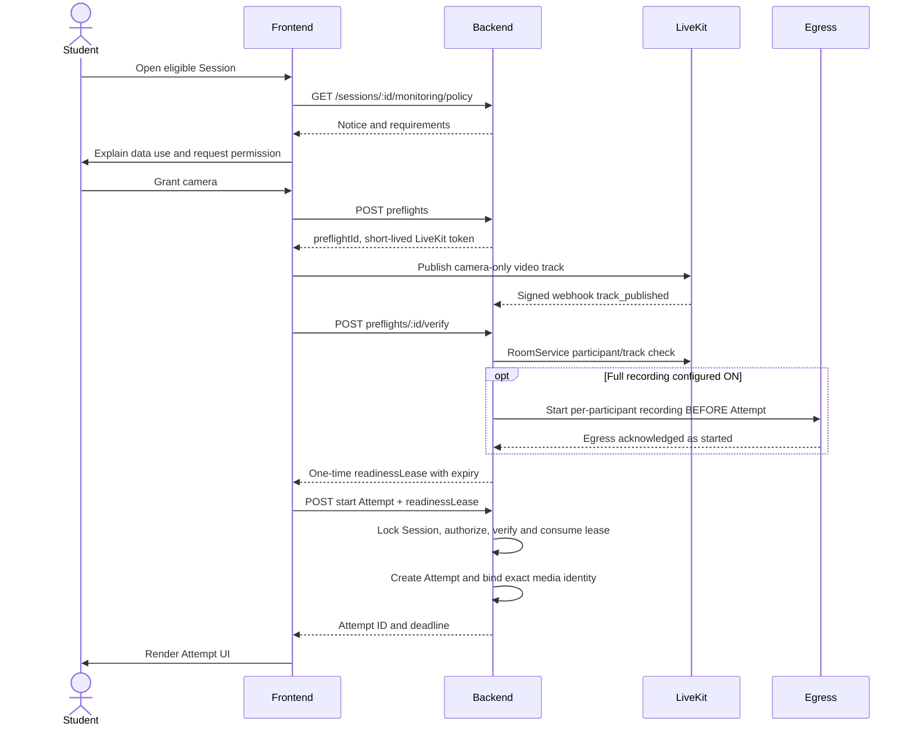
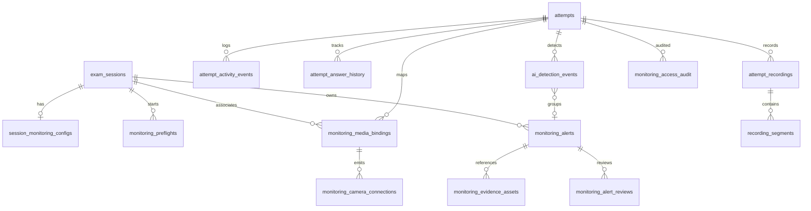
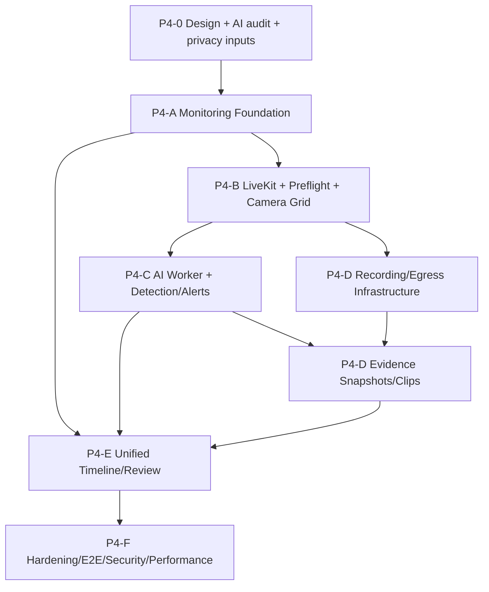

# P4 — Technical Design: Exam Monitoring, Activity Tracking & AI Proctoring

**Version:** design v1.1 (academic demo) · **Date:** 2026-11-14 · **Status:** Architecture approved, implementation gates still open.

**Baselines:** `Quizopia_System@86cdb2e`, `Quizopia_Backend@972d6a9`, `Quizopia_Frontend@7a01090`. In a future implementation, audit current branch/CI/migrations again before applying any change. **No code/repository/deployment changes are part of this delivery.**

## 1. Scope & constraints

**In-scope:** Session monitoring policy, camera preflight, teacher camera viewing, AI model adapters/alerts, browser/answer history, evidence snapshots, complete opt-in video, rolling evidence clips, timeline/review/report, retention, security, privacy, E2E + benchmarks. `PUBLIC` Sessions must never be monitored. `CLASS_RESTRICTED` requires ≥1 valid active assigned classroom before enabling. On a monitored Session, camera is mandatory; an accessibility exception is a separately authorized alternative non-monitored assessment, **not a silent bypass**.

**Non-goals:** Automatic misconduct judgments, proctoring on PUBLIC, grading changes, media payload through Spring, Kafka/K8s/Elastic by default, production deployment, processing unconsenting real students, retraining model with learner media. **Invariants:** existing Autosave/Submit/Grade correctness and optimistic/pessimistic lock ordering preserved; a camera/media/AI/storage failure cannot silently lose accepted answers or auto-punish learners.

**Approved defaults:** LiveKit self-host, room/Session, full recording OFF by default, clips through full recording or bounded buffer, MinIO dev/S3-compatible prod (future), 30d media/evidence, 90d activity metadata, AI independent service and future Git submodule. **Course-demo priority: 5 real publishers, target 10, full real-model end-to-end demonstration; 30/50/100 optional.** See ADR-008.

## 2. Source audit — integration seams

| Existing code | Observed source behavior | Integration guidance |
|---|---|---|
| `ExamSession` / `ExamSessionService` | Session status, visibility, version and ownership. `CLASS_RESTRICTED` creation can have zero assigned classes at Backend; FE form checks ≥1 | Add server-side Monitoring preconditions and freeze; don't change public general behavior unexpectedly |
| `ClassroomSessionService` and `exam_session_classes` | Session/class assignment with ownership/ACTIVE checks and window freeze | Monitoring must also prevent deleting last eligible assignment and changes inconsistent with a policy snapshot |
| `AttemptService.startAttempt` | Session row lock, eligibility, lazy open, find active Attempt, create new Attempt; resume returns existing Attempt | Consume readiness token only for **new monitored Attempt** and do it under existing session lock; allow resume while media restores |
| `AttemptAutosaveService`/`AttemptAnswerRepository` | Attempt row lock and SQL `ON CONFLICT...WHERE old.sequence < incoming.sequence`; stale save is accepted=false | Append accepted-only history within same tx; no external network wait in tx; preserve sequence guard |
| `AttemptSubmitService` | Atomic submission/grading/idempotency and after-commit event | Use after-commit observer for close/reconcile media, not synchronous blocking on recorder |
| `RealtimeEventBroadcaster` / `StompSubscribeInterceptor` | AFTER_COMMIT dispatch; allowlist personal attempt queue and teacher session topic; all SEND denied | New monitoring event destination must be explicitly allowlisted and authorized; do not loosen anti-spoof guard |
| `LiveMonitor.tsx` / `use-session-events.ts` | REST-seeded counters and last 20 ephemeral realtime events | Extend UI while maintaining existing tabs and REST recovery; use durable monitoring event API for timeline |
| `AttemptShell.tsx` / `answer-store.ts` / `use-autosave.ts` | In-memory answer state, debounce, sequence sync, submit/retry | Add low-priority telemetry adapter; avoid rerender-generated events or keystroke-level essay logging |
| `docker-compose.yml` | PostgreSQL, Redis, Backend, Frontend, MinIO, Mailpit; no LiveKit/Egress/AI | Add infra only in later implementation branch; secure credentials, network, volumes |
| Flyway schema | V32 latest on sampled main | Always choose next **free** forward-only version; never rewrite applied migration |

Source paths are in the matching GitHub repositories at the baseline HEAD; see links in README and ADR.

## 3. Container diagram



**Data plane vs control plane**: Video travels via WebRTC/SFU/recorder; REST issues instructions, tokens and metadata; STOMP carries *small* notification events, not video/large images. AI Worker gets no database credentials to Exam/Attempt/Grade. Object Storage client identity is service-specific IAM/keys. Media room/publisher identities are opaque.

## 4. Backend bounded contexts

Keep existing `exam`, `attempt`, `classroom`, `identity`, `realtime` intact; add cohesive package `monitoring` with modules (application + domain + adapters + API):

- `policy`: validated immutable MonitoringPolicy/version, session eligibility, configuration freeze, privacy notice version.
- `preflight`: media identity binding, signed/opaque readiness leases, start gate, pre-start cleanup.
- `activity`: browser batch ingestion + accepted-answer history and timeline projections.
- `media`: LiveKit integration, webhook authentication/reconciliation, media tokens, camera state.
- `detection`: trusted AI event ingress, validation, dedupe, aggregate alerts.
- `evidence`: S3 metadata, snapshot, recording/segments, playback authorization, clip processing.
- `review`: teacher annotation, decision/false positive, monitoring report.
- `retention`: scheduled S3 cleanup and tombstoning, reconcile orphaned/pre-start objects.
- `audit`: record actual actions/subject/purpose/time without leaking secrets.

**Ports/adapters:** `MediaGateway`, `EvidenceStorageGateway`, `AiEventVerifier`, `MonitoringPublisher`, `Clock`. Start by reusing existing REST/STOMP/Redis and transaction manager; no distributed transaction across Postgres/S3/LiveKit.

## 5. Monitoring policy & validation

Recommended schema (logical, not final Java records):

```yaml
schemaVersion: 1
monitoringEnabled: true
cameraRequired: true            # server-derived, never independently false when monitoring enabled
activityTrackingEnabled: true   # user-configurable; lifecycle DB events still exist
aiDetectionEnabled: true
snapshotEvidenceEnabled: true    # requires AI
fullRecordingEnabled: false     # teacher opt-in, default OFF
clipEvidenceEnabled: true       # requires AI and (full recording OR rollingBufferEnabled)
rollingBufferEnabled: true      # required when clip ON & full recording OFF
retentionDays:
  mediaEvidence: 30
  activity: 90
privacyNoticeVersion: 'p4-notice-v1'
```

**Validation matrix:**

| Case | Result |
|---|---|
| `monitoringEnabled=false` | Force dependent flags OFF; no camera preflight, preserve existing normal attempts |
| Enabled + `PUBLIC` | `MONITORING_NOT_ALLOWED_FOR_PUBLIC` (422) |
| Enabled + no active assigned owned class | `MONITORING_REQUIRES_CLASS` (422) |
| Enabled + `cameraRequired=false` from client | Reject or canonicalize to true with explicit contract; no ambiguity |
| AI OFF + snapshot/clip ON | Reject 422 |
| Clip ON + full video OFF + rolling buffer OFF | Reject 422 |
| Recording ON + Monitoring OFF | Reject 422 |
| Session has started/first Attempt exists/scheduled window crossed | Reject monitoring mutation 409 `MONITORING_POLICY_FROZEN` |
| Remove final eligible class from monitored Session | Reject 409 |

**Freeze boundary:** use `startsAt` as originally persisted at authorization time, check `Instant.now(clock) >= startsAt` before any update; Session OPEN or any attempts also freeze. Maintain `policy_version`, `frozen_at` and effective policy snapshot once frozen. For operations racing with start, lock in consistent order **Session → monitoring config**; no DB waiting for LiveKit. Rollback on failed class assignment or invalid config. Visibility must not be flipped to PUBLIC while monitoringEnabled; validate every relevant entrypoint, including standalone class assignment and Session edits.

**Ownership semantics:** teacher currently must hold DB effective permission and own Session. Keep owner-only for P4 initially, do not infer class monitor permission from being a teacher in the same school. Future delegated proctors require a separate explicitly scoped, audited role.

## 6. Media identity and authorization

`room_name` = unguessable opaque UUID/slug per Session, stored as config metadata, not exposed in a class/public URL except inside short-lived grants. Students use opaque `mediaParticipantIdentity` mapped to `(session, user, mediaConnectionEpoch, preflightId)`; never encode PII. The mapping is created **before** Attempt creation. On successful start bind exact `attempt_id` and start media coverage period; if same user takes another Attempt later create new binding epoch; never guess the newest Attempt during delayed detection callbacks.

**Token permissions:**

| Principal | LiveKit grant | Backend prerequisite |
|---|---|---|
| Student | `roomJoin=true`, room fixed, `canPublish=true`, `canPublishSources=['camera']`, `canSubscribe=false`, `canPublishData=false`; audio disabled | Eligibility, account state, active policy and preflight |
| Teacher | fixed room, `canPublish=false`, `canSubscribe=true`, no room admin unless strictly required | `EXAM_SESSION_MONITOR` and owner match |
| AI Worker | Server-only token scoped to room, subscribe only; no camera publish | Authenticated worker assignment and workload caps |
| Egress | Server API identity and room recording permissions | Recording/clip policy, recording coordinator state |

**Self-host security limitation:** removed participants can rejoin with old unexpired tokens, even if backend refuses renewal. Use low short initial TTL (suggest 60–120s *as a tunable starting point*, verify with SDK refresh), immediate RemoveParticipant + backend revocation flag, server stop issuing credentials, audit rejoin attempts, and finish room when done. Residual stale-token window remains and is a **security risk even for demo**: threat-test with actual LiveKit version. If strict immediate revocation is necessary, adjust topology/admission strategy; do not promise impossible server behavior.

**Network:** LiveKit HTTPS/WSS signaling + WebRTC ICE/UDP (or TURN fallback), trusted TLS/host networking where appropriate, public IP/NAT setup. Never assume plain Docker bridge + localhost works for remote student access. Room lifecycle: create lazily with authoritative policy; cleanup after closed and all users/recorders gone; can reconstitute on restart from DB.

## 7. Camera preflight & new Attempt gate



**Important race/failure contract:**
- Media/egress network calls happen **outside** transaction. Only after successful media preflight, FE calls existing start endpoint extended with optional opaque `monitoringReadinessLease` (backwards compatible: unmonitored Sessions accept null).
- Backend verifies expiry, ownership, session, policy version, active camera state, and one-time nonce inside session-locked start. Use row-locked lease/unique consumed marker to prevent replay; consumption/Attempt creation commit together. Repeat start after network timeout must detect existing Attempt and follow existing idempotent resume behavior; don't create duplicates.
- For recording ON, verification checks egress started *and* correct video track; `started` is not proof of durable file, and failure before start prevents new Attempt with guidance. A full-recording preflight can create transient footage. If Attempt never starts, terminate recording and delete orphan video on bounded TTL; explicitly disclose the pre-start capture.
- Preflight `getUserMedia` permission alone is **not** ready; server verifies actual published camera/video track and recent liveness. Browser preflight on unsupported/no-camera/error → truthful retry/support UI.
- **Resume:** existing IN_PROGRESS Attempt does not require a fresh gate blocking the exam, because policy D8 says camera failure/reconnect cannot interrupt answers. Trigger automatic camera recovery and a `MONITORING_GAP` event while recovering. A new Attempt always requires readiness.
- **No bypass:** absent camera for monitored Session → no *new* Attempt. Assistive accommodation is a separate documented, owner-approved non-monitored exam path; do not silently flip cameraRequired on an existing monitored Session.
- Any `maxAttempts >1`, disabled participant, teacher ownership change, policy freeze, time window expiration, concurrent start, and multi-tab media identity replacement must have tests.

## 8. Student camera lifecycle & failure handling

State machine (suggested): `NOT_REQUESTED → PERMISSION_PENDING → CONNECTING → PUBLISHING → VERIFIED → DISCONNECTED/RECONNECTING → VERIFIED`, with `DENIED`, `UNAVAILABLE`, `STOPPED`. Server media presence is authoritative for `VERIFIED`. HTTP and STOMP connection are distinct from media connectivity. Camera-loss event starts an incident, attempts reconnect with bounded backoff, restores media binding and closes incident; gap persists in Attempt timeline. No grade mutation, no forced submit or auto-penalty for infrastructure loss. Session close/Attempt submit revokes new token grants and stops recorder via after-commit reconciliation. Backend must recover state from LiveKit on startup rather than trusting webhooks exclusively (webhook delivery not guaranteed).

## 9. AI Service: adapter, source trust, queue and model versioning

Keep AI source in a **separate future repository** (`Quizopia_AI_Proctoring` tentative name, not created), added to System git submodule only after explicit implementation approval. Container image/semantic version pinned, model artifacts hashed and licensed, CI includes fake-frame tests and contract tests. Suggested Python stack is provisional until model audit.

```text
media_subscriber/     LiveKit RTC subscription + frame sampling
scheduler/            bounded per-track queue, fair-share and drop-old policy
adapters/             ModelAdapter protocol, phone/person/gaze adapters
preprocess/           model-specific normalization and resizing
aggregation/          thresholds, temporal smoothing, state, dedupe/cooldown
transport/            authenticated Backend callbacks + retry/outbox
storage/              private snapshot upload with checksum and metadata
ops/                  health, readiness, metrics, version tracking
```

**Common adapter result:** `modelId`, `modelVersion`, `frameObservedAt`, `detectionType`, `confidence`, optional bounds and opaque track identifiers. AI Worker cannot set arbitrary attempt/user IDs; Backend joins by trusted `(room, participantIdentity, trackSid, mediaEpoch)` and event time period. No result is a verdict. `LOOKING_AWAY` only enables after separate accuracy/fairness calibration. Do **not** select inference resolution/FPS or threshold before real model tests.

**Backpressure:** sample dynamically, max one or small bounded queue per track, discard superseded frames, track dropped-frame metric, cap concurrent GPU jobs, fair scheduling across students; graceful AI degradation. AI down → `AI_UNAVAILABLE` / coverage gaps, no impact on answers. Dedupe across retries by service event ID; aggregate repeated detections into alert windows with `firstSeenAt`, `lastSeenAt`, `maxConfidence`, `count`, `modelVersion`, `thresholdVersion`. A late callback must match the historical media-to-Attempt binding at *observation time*, or be quarantined; never reassign to next Attempt.

## 10. Recording and evidence clips

**Full recording OFF by default.** When ON, use per-participant camera-only Egress (current `StartEgress`/`MediaSource` APIs; revalidate pinned version) with S3-compatible output. Recorder is orchestrated by Backend state coordinator and webhook/reconciliation. Egress self-host is separate from SFU. Start before the monitored new Attempt if required; stop via after-commit submit/deadline/Session lifecycle handling. Disconnect means close or finalize a segment, then start a new segment on reconnect. `attempt_recordings` groups N `recording_segments` each with track/egress ID, start/end, object key, checksum/size, status and known gaps.

**State machine:** `PENDING → STARTING → RECORDING → FINALIZING → AVAILABLE`, with `PARTIAL` and `FAILED`, idempotent restart/reconcile. `egress_started` is acknowledged activity, not proof of uploaded artifact. `AVAILABLE` only after valid object `HEAD`, size/content check and terminal Egress success. Handle late webhooks and missing callback by polling LiveKit Egress status / storage reconciliation. Do not record audio: disable student microphone publish and configure video-only Egress.

**Evidence snapshots:** detection event selected by temporal rule → capture corresponding buffered frame → upload immutable-ish private object + checksum → persist metadata → publish alert. Distinguish upload state `PENDING/AVAILABLE/FAILED/EXPIRED`; avoid thousands of duplicate screenshots. Asset object key is generated server-side and never served as a public URL. Bounding-box overlays are derived, preserve original frame if possible.

**Evidence clip paths:**
1. **Full video ON:** find exact recording segment(s) containing alert time, extract a clip with desired pre/post window. Manage multi-segment gaps; link if source exists.
2. **Full video OFF + clips ON:** continuously preserve a **bounded** short encoded rolling buffer (not merely a handful of AI-sampled frames); propose 2–5s chunks and 30–45s total horizon as *starting design hypotheses*. On alert, pin relevant chunks until post-window arrives, generate clip asynchronously, and aggressively delete unpinned temporary chunks. This temporary buffering **is storage and video processing**: disclose in policy, secure it, and limit TTL. If buffer offline/too short, report `UNAVAILABLE`/`PARTIAL` rather than claiming past frames exist.

Clip default design hypothesis: 10 seconds before + 20 seconds after alert; **not a measured/approved performance threshold**. `clipEvidenceEnabled=true` is invalid if AI disabled or both fullRecording and rollingBuffer are OFF. Clip generation jobs are idempotent; source assets may expire after derived clip is ready, subject to the approved demo retention policy; legal holds are future-production scope.

## 11. Storage, playback and retention

**Dev:** existing MinIO; create distinct private buckets/prefixes `monitoring/snapshots`, `monitoring/clips`, `monitoring/recordings`, `monitoring/rolling-temp`. Provision service-specific read/write access; replace dev defaults, use secrets and TLS. **Future production:** choose S3-compatible provider after separate hosting/cost/security evaluation; not part of the local academic demo gate. Egress S3 upload supports MinIO with `force_path_style` and an HTTPS endpoint in supported configurations. Do not leak keys or raw object URLs.

**Playback:** request to Backend → DB permission/ownership/retention check → `monitoring_access_audit` event → short-lived scoped access. MP4 can use signed URL that supports HTTP Range; HLS playlists reference multiple segments, so a lone presigned playlist is **not sufficient**: implement authorized media gateway, short-lived segment signature policy or equivalent authenticated CDN mechanism. Validate CORS/range seek, concurrent viewers and token expiry. Use explicit evidence state `EXPIRED` when the object has been deleted but 90-day metadata remains.

**Retention:** 30-day final media/evidence after Attempt termination or object finalized per policy rule fixed in ADR; 90-day browser/AI/answer-history metadata. A periodic job marks expired metadata, deletes objects and confirms `HEAD` absence, retains *minimal non-sensitive deletion audit*, reconciles orphaned objects and retries provider failure. For the course demo, delete consenting volunteers' test videos on request using a manual purge; any future legal hold or minor/real-student deployment requires a separate compliance design. For rolling-temp buffer, use much shorter TTL measured in seconds/minutes, never 30 days.

## 12. Database logical ERD (not yet migration SQL)



| Table | Key columns (suggested) | Constraints, access/index guidance |
|---|---|---|
| `session_monitoring_configs` | `session_id PK/FK`, `schema_version`, `policy_json`, `policy_version`, `frozen_at`, `created_at`, `updated_at` | DB CHECK basic flag combinations, effective policy snapshot, version optimistic control |
| `monitoring_preflights` | `id UUID PK`, `session_id`, `user_id`, `media_identity`, `lease_hash`, `expires_at`, `consumed_at`, `status`, `policy_version` | Unique lease hash; index `(session_id,user_id,expires_at)`; opaque token never stored raw |
| `monitoring_media_bindings` | `id UUID PK`, `session_id`, `user_id`, `attempt_id NULL`, `preflight_id`, `media_identity`, `epoch`, `active_from`, `active_to` | FK/unique per identity+epoch, temporal attempt binding, no orphan-assignment; unique active binding rules |
| `monitoring_camera_connections` | `id UUID`, `binding_id`, `track_sid`, `connected_at`, `disconnected_at`, `last_verified_at`, `reason` | idempotency on `webhook_event_id`, index `(binding_id,connected_at)` |
| `attempt_activity_events` | `id UUID`, `attempt_id`, `source`, `event_type`, `client_event_id`, `client_seq`, `client_ts`, `server_ts`, `payload_sanitized`, `trust_level` | Unique `(attempt_id,source,client_event_id)`; `(attempt_id,server_ts,id)` index; size limit |
| `attempt_answer_history` | `id`, `attempt_id`, `attempt_question_id`, `accepted_seq`, `accepted_at`, `payload_hash`, `approved_snapshot_data?` | Unique `(attempt_id,attempt_question_id,accepted_seq)`; no duplicates on stale; privacy-classified optional data |
| `ai_detection_events` | `id UUID`, `worker_event_id`, `binding_id`, `attempt_id`, `type`, `model_id`, `model_version`, `threshold_version`, `confidence`, `observed_at`, `received_at`, `bbox_json` | Unique `(worker_id,worker_event_id)`; temporal mapping; `(attempt_id,observed_at,id)` |
| `monitoring_alerts` | `id`, `attempt_id`, `session_id`, `type`, `first_seen_at`, `last_seen_at`, `severity`, `review_status`, `confidence_max`, `detection_count` | aggregate not raw; `(session_id,review_status,last_seen_at)` |
| `monitoring_evidence_assets` | `id UUID`, `alert_id`, `attempt_id`, `kind`, `object_key`, `checksum`, `size_bytes`, `status`, `expires_at`, `model_version` | private key not URL; upload state, `(attempt_id,created_at)` |
| `attempt_recordings` | `id`, `attempt_id`, `policy_version`, `state`, `start_requested_at`, `finalized_at`, `failure_reason_code` | unique active logical recording/Attempt; explicit partial status |
| `recording_segments` | `id`, `recording_id`, `media_binding_id`, `egress_id`, `started_at`, `ended_at`, `object_key`, `size`, `state` | unique egress and object key where present; timestamp index |
| `monitoring_alert_reviews` | `id`, `alert_id`, `teacher_id`, `action`, `notes`, `created_at`, `version` | append-only history, latest status derived or cached transactionally |
| `monitoring_access_audit` | `id`, `actor_user_id`, `session_id`, `attempt_id`, `asset_id`, `action`, `access_at`, `purpose`, `result` | append-only audit; limited PII; retention/sign-off separate |
| `monitoring_outbox` | `id`, `event_type`, `aggregate_id`, `payload`, `status`, `retries`, `next_attempt_at` | transactional after-commit delivery for durable alert notification |

Use `attempt_id` foreign keys to authoritative `attempts` rather than copying class/workspace ownership. Avoid per-row generic userId duplicates except where essential for preflight or audit. Prefer Postgres constraints and migration tests before adding time partitioning; partition only after measurement. For concurrency tests include same-user multiple-tab start, stale seq, duplicate callback and late AI event. On main current version `V32`; select next free number only at implementation time, forward-only migrations, fresh/upgrade Testcontainers checks.

## 13. Event trust, ordering and timeline

| Type | Authoritative source | Can be lost? | Use for verdict? |
|---|---|---|---|
| Attempt created/submitted/timeout | PostgreSQL server transaction | No after commit; STOMP notice can be lost | Verified lifecycle only |
| Answer saved accepted | same autosave DB transaction | No if committed | Verified answer state |
| Select/clear/change/flag/question navigate | Browser | Yes, on crashes/offline/buffer overflow | No |
| Tab hidden/focus/fullscreen | Browser | Yes; not robust evidence of user intent | No |
| Camera connection | LiveKit signed webhook + RoomService reconciliation | Webhook can be missed; reconciled | Connectivity only |
| AI detection | Authenticated Worker | Delivery can be late; retry/idempotent | Human review needed |
| Recording started/finalized | Egress webhook + object verification | Event can be lost; reconcile | Storage status only |
| Alert review | Teacher authenticated Backend transaction | Durable | Human decision, not automatic cheating status |

**Ordering:** client `occurredAt` is untrusted; use `serverReceivedAt` + stable UUID/cursor for durable pagination and display `clientOccurredAt` as observed time with clock-skew/late label. For AI use worker observation time plus bounded clock correction and binding epoch; late events remain tagged `delayed`. Timeline index `(attempt_id, server_received_at, id)` and cursor `base64(ts,id)` or opaque signed cursor; filter by source/type/severity/time. Live push carries tiny envelope with event ID, then Frontend REST fetch/dedupe/reconcile. Existing `/topic/exam-sessions/{id}` contract stays intact; a separately allowlisted `/topic/monitoring/sessions/{id}` is proposed for monitoring domain. No student subscription to that teacher topic.

**Telemetry batching:** max payload/events, max rate and offline queue size; IndexedDB optional and privacy-reviewed, retry with same client_event_id, drop oldest on overflow and mark gap; no essay keystroke capture. `visibilitychange`/`pagehide` notifications best-effort and may not fire; do not represent their absence as cheating. `performance.now`/client sequence only hints, not authoritative order.

## 14. Realtime frontend and teacher UX

Existing teacher session detail contains LiveMonitor, Participant Management and Results/Statistics; preserve these. Add monitoring summary, Camera Grid, Alert Feed and open Student Monitoring Detail. Keep current app navigation, `DESIGN.md` and accessibility. **Do not replace** Results & Statistics. Suggest separate hooks `useMonitoringOverview`, `useMonitoringEvents`, `useCameraSubscription`, `useAttemptTimeline`, `useEvidenceAsset`. After reconnect, invalidate/fetch durable cursor from server; do not rely on 20-element volatile feed. Student landing shows policy before permission request; device test includes preview, explicit errors, retry, and device-accessibility copy; monitored Attempt UI shows camera/record status, not intrusive full-screen blocking overlays. The AttemptShell and autosave UI remain responsive if video is unstable.

**Teacher layout:** summary counts (started, IN_PROGRESS, truly connected, disconnected, AI coverage, new alerts), virtualized Camera Grid with viewport-based subscribe, student roster, timeline and review. Use low simulcast layer for grid and high layer for focused view, with explicit privacy indicator. A teacher viewing 100 participants does not require 100 high-quality subscription streams. Keyboard/focus testing, loading/error/empty states and reduced-motion support required.

## 15. Security threat model

1. **IDOR/cross-session:** every REST read/write derives Session/Attempt ownership from database. Do not trust `sessionId` in browser event payload beyond server-verified Attempt relationship.
2. **Token theft/replay:** short TTL, minimal grants, private TLS, never log bearer; app-level revocation, remove participant, residual selfhost risk explicitly tested.
3. **Student stream isolation:** `canSubscribe=false`, no data publish, no audio/screen track; smoke tests connect two students and attempt malicious subscription.
4. **Teacher overreach:** require DB-backed `EXAM_SESSION_MONITOR` + creator ownership and audit media token issuance; no class-derived automatic view rights.
5. **AI forgery:** mTLS or shared service JWT with rotation, signature/nonce/timestamp, allowlisted network, idempotent eventID, known worker/model version and media binding.
6. **LiveKit webhooks:** verify signed payload/authenticator (use official validation library and unmodified body); tolerate duplicates/reordering and missing deliveries.
7. **Object storage:** private bucket, least privilege, HTTPS, S3 encryption at rest, private short-lived grants, scoped HLS playlist/segment access, audit grants and access.
8. **Over-collection:** no audio by default; no automatic facial recognition identity inference; no training reuse; strict TTL for rolling buffer; content redaction option for screenshots.
9. **Evidence integrity:** original object checksum, capture metadata, immutable review history; a teacher annotation never modifies original evidence.
10. **DoS/backpressure:** cap REST batch size/rate, AI queues, stream resolutions, recording concurrency and asynchronous extraction jobs. No media blocking in attempt critical tx.

## 16. Reliability / recovery matrix

| Failure | Expected behavior | Recovery / evidence |
|---|---|---|
| Camera denied at preflight | No new monitored Attempt | actionable error / alternative assessment process; no hidden bypass |
| Camera disconnected after start | Attempt and autosave continue | incident timestamps, reconnect, resubscribe, recorder segment handling |
| AI service down | No AI alerts; do not claim monitored inference | `AI_UNAVAILABLE` gap, durable health status, restart/failover |
| LiveKit down | Existing Attempt remains valid; media degraded | REST camera gap, retry, reconcile room after restart |
| STOMP disconnected | REST remains authoritative | fetch since cursor on reconnect; event loss not permanent |
| Egress fails or final file missing | `FAILED/PARTIAL`, not `AVAILABLE` | retry with new segment if Attempt active; alert teacher, object reconciliation |
| MinIO/S3 unavailable | Evidence/recording degraded, answers unaffected | retry object jobs, bounded queue, clear failure status, no infinite frame buffer |
| Browser crashed/reloaded | Attempt resumes by existing mechanism | attempt status/deadline from server, camera re-preflight/reconnect; telemetry gap |
| Late/duplicate AI callback | Normalize and de-dupe | verify binding at observed time; quarantine ambiguous callbacks |
| Class/teacher permission revoked | No new token/REST access | remove current participant, reject renewals, self-host stale-token residual noted |
| Timer expires while media broken | Existing server deadline governs | submit/timeout logic unchanged, mark monitoring gap only |

**Required tests** include fault injection for each row, real browser E2E (fake cameras where deterministic), real media Egress, and real-model verification separate from stubs.

## 17. Capacity/cost planning — illustrative only (demo first)

Assume **0.8 Mbit/s** per student video, 60-minute sitting, **1.5 sampled frames/s**/student by AI (model requirement unverified), one teacher grid with selective low-layer subscription. Published camera ingress `N * 0.8 Mbps`; recording per hour `N * 0.8 * 3600 / 8 / 1000 = 0.36N GB` (decimal GB, excludes overhead). Thus 10/30/50/100 publishers imply ~8/24/40/80 Mbps ingress; ~3.6/10.8/18/36 GB per recorded 60-min sitting; 15/45/75/150 sampled frames/s. **These are estimates, not demonstrated limits.** Egress (to teacher, AI Worker, recorder) can substantially exceed ingress. GPU capacity must be measured from real model latency, batch ability and resolution. Rolling buffer can incur video processing and storage even with full recording OFF.

Benchmark **5 → 10** concurrent publishers as the mandatory course-demo gate (1 teacher viewer, real AI and optional recording/clip path). Add 30 → 50 → 100 only as **optional stretch experiments** if hardware supports them. Collect p50/p95/p99 startup, frame processing, alert latency, room join, Egress start/finalize, error/reconnect rate, network ingress/egress, CPU/GPU VRAM and S3 storage performance. Project costs using actual target geography/provider, bandwidth egress, CPU/GPU hourly, object storage and retention. No capacity promise before successful benchmark.

## 18. Staged implementation / dependency graph



- P4-A: policy, class constraints, freeze, browser activity, accepted-answer history, base timeline.
- P4-B: media infra, credentials, readiness lease, teacher selective camera grid, reconnection.
- P4-C: model adapter, bounded inference, aggregate alerts, AI callbacks; model evaluation gate.
- P4-D: private object storage, snapshots, recording/segments, rolling buffer clips, playback/retention.
- P4-E: student detail, unified timeline, alert review + teacher report and UX integration.
- P4-F: demo reliability, E2E 5–10 streams, fault recovery, basic security/notice/retention tests and reproducible local runbook; scale beyond 10 and production legal audits deferred.

Issue drafts in `ISSUES_DRAFT.md`. No implementation work starts until independent review and owner authorization of corresponding milestone.

## 19. Decision log: unresolved details, not guessed

| Open item | Owner / gate |
|---|---|
| Real model repo, artifact formats, runtime, detection schema, thresholds, precision/recall, inference FPS and target HW | AI model audit (P4-C blocked until evidence) |
| `MediaSource`+Egress deployment/version, exact video segment start assurance, HLS vs MP4 chosen output | P4-B/P4-D measured integration spike |
| Whether rolling buffer needs separate custom worker versus suitable segment-based Egress architecture under load | P4-D benchmark |
| Timeout values (token TTL, readiness lease, cooldown, reconnect backoff) | Implementation spike; initial placeholders only |
| Consenting adult demo participants, notice and authorized footage | Academic demo gate; full legal review only if future real-student use |
| Production S3 provider, region, quotas, cost ceiling, GPU infrastructure | Deferred unless course demo explicitly requires remote deployment |
| Future co-proctor roles and separate `CAMERA_VIEW` permission beyond session owner | New ADR if product expands access model |

## 20. Acceptance criteria for the **whole Phase 4**

1. Monitoring only for eligible class-restricted Sessions; cannot enable on PUBLIC or with zero classes.
2. Student sees a disclosed notice and completes server-verified camera preflight before a **new** monitored Attempt.
3. Teacher sees authorized live cameras; other learners cannot subscribe or fetch recordings.
4. AI real model detections are measured and versioned; service failures do not alter Attempt results.
5. Browser activities and accepted answer history are stored with unambiguous trust and ordering semantics.
6. Evidence snapshots and clips are private, hashed, audited and have accurate availability states.
7. Teacher-opt-in full recording stores correct Attempt video/segments; reconnect gaps are explicit, default OFF.
8. Unified timeline survives reload/reconnect and distinguishes client vs server events and false positives.
9. Review/report workflow is authenticated and no automated disciplinary conclusions exist.
10. Cleanup enforces 30d media / 90d metadata policy, including orphaned preflight and rolling data; manual purge of demo media is available.
11. Existing autosave/submit/grading regressions green; auth/IDOR tests green.
12. Real browser/media/inference integration + **5/10 publisher** benchmark evidence documented. Larger scale (30/50/100) is optional; no fabricated PASS metrics.
13. Academic demo safety/security checklist and reproducible local runbook verified. Real-student/production release requires a separate future gate.

## 21. Source/document references

- Quizopia Backend: https://github.com/hhtuann/Quizopia_Backend/tree/972d6a9
- Quizopia Frontend: https://github.com/hhtuann/Quizopia_Frontend/tree/7a01090
- Quizopia System: https://github.com/hhtuann/Quizopia_System/tree/86cdb2e
- LiveKit deployment: https://docs.livekit.io/transport/self-hosting/deployment/
- LiveKit self-host token caveat: https://docs.livekit.io/frontends/reference/tokens-grants/
- LiveKit Egress new API and outputs: https://docs.livekit.io/transport/media/ingress-egress/egress/ ; https://docs.livekit.io/transport/media/ingress-egress/egress/outputs/
- LiveKit webhook retry semantics: https://docs.livekit.io/intro/basics/rooms-participants-tracks/webhooks-events/
- VN law: https://vanban.chinhphu.vn/?docid=214590&pageid=27160&typegroupid=3 ; https://vanban.chinhphu.vn/?classid=1&docid=216387&pageid=27160&typegroupid=4

## 22. Course demo — golden path (new in v1.1)

**Minimum demonstrable flow:** teacher creates an assigned `CLASS_RESTRICTED` Session, turns Monitoring ON, optionally enables Full Recording; 5 consenting adult testers (target 10) launch browser cameras and pass Backend-verified preflight; teacher sees actual streams; a student picks/changes answers and switches tab; the **real** AI model detects a phone and another person; backend groups detections into alerts; teacher sees realtime alert, views a private snapshot and evidence clip near the event; recording can be played when ON; student submits; teacher reloads and sees complete persisted timeline, alert review and summary report. Evidence when recording is OFF must come from a working bounded buffer, not fabricated past footage.

**Demo switches:** deterministic demo seed users/classes/sessions; optional *synthetic camera source* to reproduce media load without many physical cameras (explicitly labeled as synthetic); stub AI only for unit/integration tests, not final model verification; environment files hold only placeholder secrets in documentation. Never bake actual personal credentials into source.

**Failure demonstrations:** student kills camera stream -> incident + reconnect while Attempt answers still save; AI Worker outage -> AI unavailable without answer loss; Egress failure -> `PARTIAL/FAILED` rather than false AVAILABLE; teacher reconnects STOMP -> REST cursor reloads events.

**Demo environment definition:** Windows host + Docker Compose preferred; report CPU/GPU, RAM, model framework, browser versions, webcam count, actual model FPS/latency. All numeric targets remain observational until measured; if real model cannot sustain 5 streams, document the bottleneck and prioritize correctness/accuracy over fake PASS.
